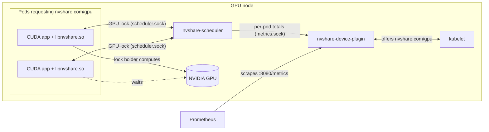
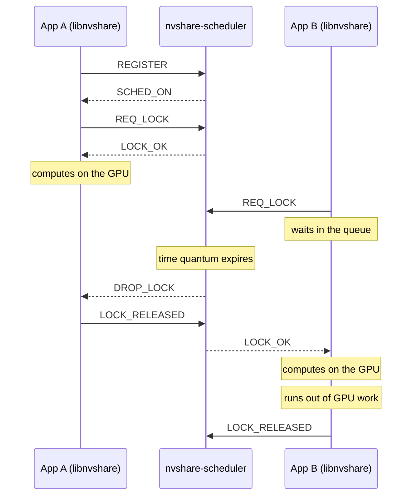

# nvshare: Practical GPU Sharing Without Memory Size Constraints

`nvshare` lets multiple processes, or containers on Kubernetes, run on the same physical NVIDIA GPU at the same time, each with the whole GPU memory available.

It transparently enables GPU page faults (CUDA Unified Memory) and uses system RAM as swap space. To avoid thrashing, `nvshare-scheduler` gives one process at a time exclusive access to the GPU for a time quantum (TQ, 30 seconds by default).

NVIDIA's device plugin assigns GPUs to containers one-to-one. That wastes the GPU on applications that only use it in bursts, such as Jupyter notebooks and other interactive work.

> This is the [ateleris](https://github.com/ateleris) fork of [grgalex/nvshare](https://github.com/grgalex/nvshare) by Georgios Alexopoulos. It is based on upstream as of April 2024 and developed independently since. It adds Prometheus metrics for the GPU time of every pod, versioned container images and automated tests.

## Contents

- [Use cases](#use-cases)
- [Features](#features)
- [How it works](#how-it-works)
- [Requirements](#requirements)
- [Deploy on Kubernetes](#deploy-on-kubernetes)
- [Run on a local system](#run-on-a-local-system)
- [Configuration](#configuration)
- [Build Docker images](#build-docker-images)
- [Further reading](#further-reading)
- [License](#license)

## Use cases

- Run two or more processes or containers with infrequent GPU bursts on the same GPU, for example interactive applications or ML inference.
- Run two or more non-interactive workloads, for example ML training, on the same GPU to reduce queueing and their total completion time.

## Features

- One GPU shared among multiple processes or containers.
- Memory and fault isolation: co-located processes use different CUDA contexts, unlike NVIDIA MPS.
- Transparent to applications, no code changes needed.
- Every process has the whole GPU memory available.
  - Unified Memory swaps GPU memory to system RAM.
  - The scheduler serializes overlapping GPU work to avoid thrashing, and applications release the GPU early when they are idle.
  - Applications whose memory fits on the GPU together use it in parallel.
- Device plugin for Kubernetes.
- Prometheus metrics for the GPU time of every pod.

## How it works

### Key idea

1. With `cudaMalloc()`, the memory allocations of all CUDA applications together must fit in GPU memory (`Σ(mem_allocs) <= GPU_mem_size`).
2. Replacing every `cudaMalloc()` call with `cudaMallocManaged()`, that is, transparently forcing the use of CUDA's Unified Memory API, does not affect correctness and costs about 1% in performance.
3. With (2), constraint (1) no longer holds for an application written with `cudaMalloc()`.
4. When GPU memory is oversubscribed (`Σ(mem_allocs) > GPU_mem_size`), the working sets of the co-located applications, the data they are *actively* using, may not fit in GPU memory (`Σ(wss) > GPU_mem_size`). NVIDIA's own scheduler switches between applications every few milliseconds, which then causes thrashing. `nvshare-scheduler` serializes GPU work to prevent this.
5. While `Σ(mem_allocs)` still fits in GPU memory, thrashing cannot happen. The scheduler detects this and lets the applications use the GPU in parallel.
6. If `Σ(wss) <= GPU_mem_size` although `Σ(mem_allocs)` does not fit, the anti-thrashing mode of the scheduler can be turned off by hand.

### Components

- **`libnvshare.so`** is injected into CUDA applications through `LD_PRELOAD`. It turns normal memory allocations into Unified Memory allocations, tells the scheduler how much memory the application has allocated, and asks it for the GPU whenever the application wants to compute on it.
- **`nvshare-scheduler`** manages one GPU. While the memory of all clients fits on the GPU together, it gives the GPU lock to every client that asks. Otherwise it hands the lock to one client at a time, first come first served, and a client keeps it for at most TQ seconds while others wait for it.
- **`nvsharectl`** is a command-line tool to configure a running scheduler.
- **`nvshare-device-plugin`** (Kubernetes only) takes one `nvidia.com/gpu` from NVIDIA's device plugin, offers it as several `nvshare.com/gpu` devices, injects `libnvshare.so` into the pods that request one, and serves the metrics.



### Scheduling

While other applications wait, each application uses the GPU for at most TQ seconds. It releases it early when it has nothing to compute. An application that nobody waits for keeps the lock past its TQ and gives it up as soon as another one asks. When it needs the GPU again, it asks the scheduler again, and once it holds the lock it gradually fetches its data back to the GPU through page faults.



#### Parallel use while the memory fits

Applications can only thrash when their memory does not fit on the GPU together. The scheduler adds up the GPU memory that all connected applications have allocated, plus 1.5 GiB each for their CUDA context, and compares it with the size of the GPU memory:

- While the sum fits, every application that asks for the lock gets it at once, and they compute at the same time. Nobody waits, and the TQ has no effect.
- When the sum no longer fits, the scheduler asks all lock holders but one to give the lock back, and the applications take turns as described above. They go back to parallel use as soon as the memory fits again, for example when one of them exits.

What counts:

- Allocated memory, not the memory an application is actively using, so the scheduler errs on the side of taking turns. A framework that reserves most of the GPU memory at startup, as TensorFlow does by default, never fits next to another application.
- Every connected application, including the ones that are idle at the moment.
- Memory allocated with `cudaMalloc()`. Memory that an application allocates as Unified Memory itself is not counted.
- Only applications that use `nvshare`. The scheduler does not see memory that other processes use on the same GPU.
- Growth at once, and freed memory once the application has been idle for a few seconds.

An application that runs with an older `libnvshare` does not report its memory. While one is connected, all applications take turns.

The scheduler trusts what the applications report. An application that reports less memory than it has can make the others thrash, just as any application that reaches the scheduler socket can turn the anti-thrashing mode off. Where the applications on a GPU do not trust each other, turn parallel use off.

Parallel use is on by default. Turn it off with `NVSHARE_PARALLEL=0` on the scheduler or with `nvsharectl -P off`, and the applications always take turns.

#### Anti-thrashing mode

Taking turns is what prevents thrashing when the memory does not fit. This anti-thrashing mode is on by default. If the working sets of the applications fit in GPU memory although their allocations do not, you can turn it off with `nvsharectl -S off`. All applications then use the GPU freely. There is no automatic detection of thrashing, so this is your call.

#### Choosing the time quantum

> The TQ only has an effect while applications take turns.

A larger TQ favors throughput, a smaller one favors responsiveness.

- Do not go below about 10 seconds. An application that just got the lock needs a few seconds to fetch its pages before it can compute.
- For a set of batch jobs, a very large TQ minimizes the total completion time. Without `nvshare` they would not fit in memory together and would have to run one after another. With `nvshare` only their GPU parts run serialized, their CPU parts run in parallel, and each job holds the GPU only while it has GPU work.

### Memory oversubscription for a single process

Every co-located process can use the whole physical GPU memory. By default a single process cannot allocate more than that, because it would thrash on its own, regardless of other processes. An application that tries gets `CUDA_ERROR_OUT_OF_MEMORY`.

Set `NVSHARE_ENABLE_SINGLE_OVERSUB=1` for an application to allow it. Expect degraded performance.

## Requirements

### Cluster

- An NVIDIA GPU of the Pascal generation (2016) or newer, on Linux. `nvshare` relies on the dynamic page fault handling that Unified Memory got with Pascal.
- One shared GPU per node. The scheduler always uses the GPU with ID 0.
- x86-64 nodes. The images are built for `linux/amd64` only.
- [NVIDIA's device plugin](https://github.com/NVIDIA/k8s-device-plugin). The `nvshare` device plugin takes one `nvidia.com/gpu` per node and offers it as `nvshare.com/gpu`.
- The scheduler, device plugin and `libnvshare` images from the same release.
- The scheduler runs with `hostPID: true` and a read-only mount of `/var/log/pods` to find out which pod a client really runs in. Without them, the pod names in the metrics are whatever the clients report. Linux 6.5 or newer makes this check complete; older kernels work.
- The scheduler and the device plugin run as root, and the `nvshare-lib` container of the device plugin runs privileged.

### Workloads

- Request `nvshare.com/gpu: 1` instead of `nvidia.com/gpu`.
- glibc 2.34 or newer in the container image, for example Ubuntu 22.04+, Debian 12+ or RHEL 9+. Older images such as Ubuntu 20.04 and Debian 11, and musl-based images such as Alpine, are not supported.
- x86-64 container images.
- A dynamically linked application. `nvshare` is injected through the `LD_PRELOAD` variable that the device plugin sets, so do not overwrite it.

## Deploy on Kubernetes

### Install

Pick a [release](https://github.com/ateleris/nvshare/releases) and apply its manifests:

```bash
NVSHARE_VERSION=v1.2.0
BASE=https://raw.githubusercontent.com/ateleris/nvshare/${NVSHARE_VERSION}/kubernetes/manifests

kubectl apply \
  -f ${BASE}/nvshare-system.yaml \
  -f ${BASE}/nvshare-system-quotas.yaml \
  -f ${BASE}/device-plugin.yaml \
  -f ${BASE}/scheduler.yaml \
  -f ${BASE}/metrics-service.yaml
```

This creates the `nvshare-system` namespace with its ResourceQuotas, the `nvshare-device-plugin` and `nvshare-scheduler` DaemonSets and the `nvshare-metrics` Service. The manifests of a release pin all images to that release.

The device plugin manages one GPU on every GPU node and offers it as 10 `nvshare.com/gpu` devices by default, so up to 10 containers can share the GPU. Its pods stay pending on nodes without a GPU.

### Use

Request an `nvshare.com/gpu` device in the `limits` of your container, where you would otherwise request `nvidia.com/gpu`:

```yaml
resources:
  limits:
    nvshare.com/gpu: 1
```

### Configure the scheduler

The scheduler is a DaemonSet, so there is one `nvshare-scheduler` per node. Find the pod on the node you want to change and run `nvsharectl` in it:

```bash
kubectl get pods -n nvshare-system -o wide
kubectl exec -ti <scheduler-pod> -n nvshare-system -- nvsharectl -T 60
```

See [Configuration](#configuration) for the options.

### Metrics

The device plugin serves Prometheus metrics on port 8080 (`/metrics`) of every GPU node: how long each pod held the GPU, how long it waited for it, and the state of the scheduler.

The pod names in the metrics do not come from the pods themselves. The scheduler looks up the pod of every client process, so a pod cannot report GPU time under another pod's name.

If you use the Prometheus Operator, also apply `metrics-servicemonitor.yaml` from the same directory.

See [METRICS_IMPLEMENTATION.md](METRICS_IMPLEMENTATION.md) for the list of metrics, example queries and what to watch when upgrading.

### Test

Run the GPU test workload twice at the same time, with different pod names. Use the tag of the release you deployed:

```bash
kubectl run gpu-test-1 --rm -i --restart=Never \
  --image=ghcr.io/ateleris/nvshare:gpu-test-v1.2.0 \
  --override-type=strategic \
  --overrides='{"apiVersion":"v1","spec":{"containers":[{"name":"gpu-test-1","resources":{"limits":{"nvshare.com/gpu":"1"}}}]}}' \
  -- --mem-mib 4096 --seconds 120
```

Each run prints `libnvshare loaded: yes`, how long it waited for the GPU, and `PASS` at the end.

Two runs of 4096 MiB fit on most GPUs together, so they run in parallel and neither waits. To see them take turns, give each more than half of the GPU memory with `--mem-mib`, or turn parallel use off with `nvsharectl -P off`. The logs of the `nvshare-scheduler` pod on that node then show the `REQ_LOCK`, `LOCK_OK` and `DROP_LOCK` messages as the two pods take turns.

### Uninstall

```bash
kubectl delete \
  -f ${BASE}/metrics-service.yaml \
  -f ${BASE}/scheduler.yaml \
  -f ${BASE}/device-plugin.yaml \
  -f ${BASE}/nvshare-system-quotas.yaml \
  -f ${BASE}/nvshare-system.yaml
```

## Run on a local system

### Build and install

> These instructions assume a Debian-based system. Build on the system you will run on: the binaries need the glibc version they were built against, or a newer one.

```bash
sudo apt update && sudo apt install gcc make libc6-dev
git clone https://github.com/ateleris/nvshare.git
cd nvshare/src
make libnvshare.so nvshare-scheduler nvsharectl

sudo install libnvshare.so /usr/local/lib/ && sudo ldconfig /usr/local/lib
sudo install nvshare-scheduler /usr/local/sbin/
sudo install nvsharectl /usr/local/bin/
```

### Use

1. Start the scheduler. It keeps its UNIX sockets under `/var/run/nvshare`, so it must run as root:

   ```bash
   sudo nvshare-scheduler
   ```

2. Launch your CUDA application with `libnvshare.so` preloaded. The library detects whether it runs in a CUDA application and only then talks to the scheduler.

   ```bash
   LD_PRELOAD=libnvshare.so <your program> <your arguments>
   ```

   Where setting environment variables is hard, for example for the notebooks a Jupyter server spawns, add the library to `/etc/ld.so.preload` instead:

   ```bash
   sudo bash -c 'echo -ne "\n/usr/local/lib/libnvshare.so" >> /etc/ld.so.preload'
   ```

3. Optionally configure the scheduler with `nvsharectl`, see [Configuration](#configuration).

### Test

`tests/gpu-e2e.sh` starts a scheduler and runs two GPU workloads against it, twice: first they must hold the lock at the same time, then, with parallel use turned off, they must take turns. It is the test CI runs on a real GPU. It needs the three binaries and the `gpu-test` workload in one directory:

```bash
mkdir bin && cp src/libnvshare.so src/nvshare-scheduler src/nvsharectl bin/
id=$(docker create ghcr.io/ateleris/nvshare:gpu-test-v1.2.0)
docker cp "$id":/usr/local/bin/gpu-test bin/ && docker rm "$id"
sudo tests/gpu-e2e.sh bin
```

To see what the anti-thrashing mode does, run more workloads than fit in GPU memory, watch `nvidia-smi`, and turn the mode off with `nvsharectl -S off`. Throughput and GPU power draw fall as page faults take over. `nvsharectl -S on` brings them back.

## Configuration

`nvsharectl` configures a running scheduler:

| Option | Effect |
|---|---|
| `-T`, `--set-tq=n` | Set the time quantum to `n` seconds. The quantum of the application that holds the GPU starts over. |
| `-S`, `--anti-thrash=on\|off` | Turn the anti-thrashing mode on or off. When it is off, all applications use the GPU freely. |
| `-P`, `--parallel=on\|off` | Turn parallel use on or off. When it is off, applications take turns even if their memory fits on the GPU together. |

Environment variables of an application that uses `nvshare`:

| Variable | Effect |
|---|---|
| `NVSHARE_DEBUG=1` | Print debug logs. |
| `NVSHARE_ENABLE_SINGLE_OVERSUB=1` | Let the application allocate more memory than the GPU has. |
| `NVSHARE_USE_ORIGINAL_MEMINFO=1` | Report the real free GPU memory to the application instead of the total minus a 1.5 GiB reserve. |

Environment variables of the scheduler and the device plugin:

| Variable | Component | Effect |
|---|---|---|
| `NVSHARE_DEBUG=1` | scheduler | Print debug logs. |
| `NVSHARE_TQ` | scheduler | Time quantum in seconds at startup, 30 by default. `nvsharectl -T` changes it until the next restart. |
| `NVSHARE_PARALLEL=0` | scheduler | Start with parallel use turned off. `nvsharectl -P` changes it until the next restart. |
| `NVSHARE_VIRTUAL_DEVICES` | device plugin | Number of `nvshare.com/gpu` devices to offer per GPU. Required, 10 in the provided manifest. |
| `NVSHARE_METRICS_PORT` | device plugin | Port of the metrics endpoint, 8080 by default. |

## Build Docker images

Released images are on `ghcr.io/ateleris/nvshare` and are built by the release workflow. To build your own:

```bash
git clone https://github.com/ateleris/nvshare.git
cd nvshare
make build
```

This builds the scheduler, device plugin and `libnvshare` images as `nvshare:<component>-<commit>`. Set `IMAGE` in the `Makefile` to your own repository, run `make push`, and point the manifests under `kubernetes/manifests` at your images.

## Further reading

- The thesis `nvshare` is based on: Georgios Alexopoulos, "Dynamic memory management for the efficient utilization of graphics processing units in interactive machine learning development", July 2021, http://dx.doi.org/10.26240/heal.ntua.21988. The title and first part are in Greek, the second part is the full thesis in English.
- [Presentation of `nvshare`](https://docs.google.com/presentation/d/16aIY0WLZutHHMZ9LJ0kCc78A5Inm5rh0P1FqNYzzCeg) (Google Slides).
- [Explanation and demonstration](https://www.youtube.com/watch?v=9n-5sc5AICY) (video).
- [GPU virtualization in Kubernetes: challenges and state of the art](https://grgalex.medium.com/gpu-virtualization-in-k8s-challenges-and-state-of-the-art-a1cafbcdd12b) (article).

## License

Apache License 2.0, see [LICENSE](LICENSE).
